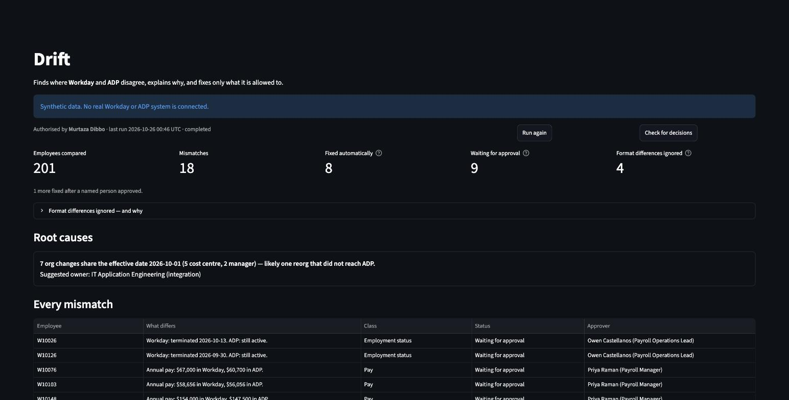
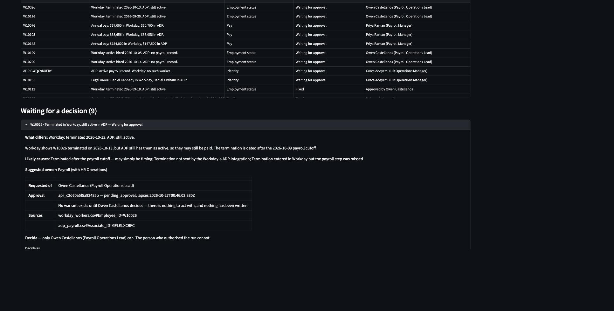

# Drift

**Finds where Workday and ADP disagree, explains why, and fixes only what it is allowed to.**

HR runs on several systems that are supposed to agree and slowly stop agreeing. Workday is the
system of record for people; ADP pays them. When a termination, a pay change or a reorg doesn't
make it across, nobody owns the gap — it sits between two platforms until payroll is wrong. Drift
compares the two, ignores the differences that are only formatting, explains each real mismatch,
rolls shared causes up into one root cause, and corrects what it is allowed to. Routine fixes go
through on their own, each under a warrant. Anything touching pay, employment status or identity
waits for a named person, who is never the person who ran it.

> **Synthetic data.** Everything here is generated: a fictional company (Northpine), fictional
> people and fictional approvers. No real Workday or ADP system is connected.





---

## Run it

Prerequisites: **Python 3.11+**, **[Deno](https://deno.com)** and `openssl`. Tested on macOS.

```bash
make setup     # .venv, Python packages, Warrant's dependencies
make demo      # the narrated demo, then the review page on the same run
```

`make demo` regenerates the data, starts its own Warrant (in-memory ledger, a fresh random
token), and narrates the five beats below, pausing for Enter before each one. Then it opens the
review page at http://localhost:8501 on the same run. **Ctrl-C** stops the page and Warrant
together. The demo keeps its own state in `state/demo/`, so it never touches what `make run`
keeps.

An Anthropic API key is optional. With `ANTHROPIC_API_KEY` set in `.env`, each mismatch gets a
plain-English explanation from Claude (`DRIFT_MODEL`, default `claude-sonnet-5-5`). Without one,
a deterministic template per mismatch type is used. Either way the explanation is advisory and
cannot change what happens.

| Target | What it does |
|---|---|
| `make demo` | The five beats, narrated, then the review page — one Warrant lifetime |
| `make app` | The review page on Drift's persistent state (run, decide and audit from the browser) |
| `make run` | Compare, govern every mismatch, write `reports/run_<ts>.md` |
| `make approve REF=W10026 AS="Owen Castellanos"` | Decide a held correction as the named approver (`DECISION=rejected` to reject) |
| `make sync` | Write and commit the held corrections a person has approved |
| `make show REF=W10015` | One correction as Warrant holds it: purpose, sources, approval, what was written |
| `make test` | 308 Python tests (including runs against a real Warrant) and Warrant's 56 tests |
| `make warrant` | Warrant alone, in the foreground, on http://localhost:8000 |
| `make data` | Regenerate the synthetic data (identical bytes every time) |
| `make reset` | Delete all generated state and reports |

`run`, `approve`, `sync`, `show` and `app` each start their own Warrant with a persistent ledger
(`state/ledger.jsonl`), so a request held by `make run` still exists when `make approve` decides
it. The CLI behind them is `python -m drift.cli`.

## The demo, in five beats

1. **"Here are 200 employees in Workday and ADP. Drift compared them."** 201 people compared (200
   Workday workers, plus one ADP record nobody in Workday owns), 18 real mismatches, and 4 format
   differences correctly ignored: email case or spacing, an hourly rate held as annual pay, a
   preferred name.
2. **"Routine fixes went through on their own — each one has a warrant."** 8 cost-centre and
   manager fixes were applied automatically. Open one: its purpose was written for that record,
   it cites both source rows, and the ADP change is shown (Home_Department 410 → 420).
3. **"This is a terminated employee still active in payroll. Drift did not touch it."** W10112 is
   held for Owen Castellanos. The person who ran Drift tries to approve it and Warrant refuses —
   approval needs a second person. Owen Castellanos approves and the fix is written.
4. **"Here's the pattern it found."** 7 org changes share the effective date 2026-10-01 — one
   reorg that never reached ADP. That's an integration ticket for IT, not seven manual fixes.
5. **"And the record can be checked."** `GET /verify` recomputes every hash in the ledger:
   intact.

## How it works

```
  Workday export ──┐
                   ├─► match ─► detect ─► explain + root causes ─► govern ─► review page · report · CLI
  ADP export ──────┘                                                 │
                                                                     │  POST /warrant
                                                                     ▼
                                                  Warrant — a separate process, with its own ledger
                                                    200 issued   → write the ADP copy, then commit
                                                    202 held     → a named person decides first
                                                    422 refused  → nothing is written
                                                    no answer    → the run stops; nothing is written
```

Drift is Python. **Warrant** is a small Deno service that runs as its own process; Drift talks to
it over HTTP only. Warrant decides whether an action may run, and it keeps an append-only,
hash-chained ledger of what was authorised. The thing taking the action is not the thing keeping
the record. In production Warrant would be a separate service owned by IT, shared by every HR
automation; it is bundled here (`warrant/`, see `warrant/VENDORED.md`) so the demo runs with one
command.

A correction reaches ADP only with a warrant id that came from Warrant: issued immediately for a
routine fix, or issued after a named person approved. Before writing, Drift reads the warrant back
and checks it is for exactly this change. Fixes are written to a copy of ADP
(`state/adp_current.csv`); the source exports are only ever read.

| Class | Fields | What happens | Who decides |
|---|---|---|---|
| routine | cost centre, manager | warrant issued, fix written and committed | nobody — automatic |
| compensation | pay | held | Priya Raman, Payroll Manager |
| employment_status | termination, missing from payroll | held | Owen Castellanos, Payroll Operations Lead |
| identity | legal name, a record ADP has but Workday doesn't, anything unrecognised | held | Grace Adeyemi, HR Operations Manager |

The approvers are fictional. The table lives in `config/change_classes.yaml`, and the loader
refuses a version that makes pay, status, a record or a name routine. More detail:
[`docs/architecture.md`](docs/architecture.md).

### What the ledger records

Each warrant issued or held, each decision (approved or rejected) and each committed or aborted
result is an event in Warrant's hash-chained ledger. **A refused request leaves no event** — a
policy refusal (422), or a decision Warrant refuses, such as the principal trying to approve their
own run. It never became an action. Drift records a refused request in `state/drift.db` and the
run report; a refused decision is shown to the person who tried to make it.

## Governance decisions

1. **The classifier is not the LLM.** Which changes need a human comes from a static table a
   person reviews, with a test proving no pay, status, record or name field can be classed
   routine. The LLM only writes explanations; nothing it writes can change what happens.
2. **Data minimisation.** The LLM sees pseudonymous IDs and the differing fields only: pay as a
   percentage, names and emails withheld. Nothing sent to Warrant carries a pay figure, a name or
   an email, because the ledger is exportable. That includes the mismatch fingerprint, which is a
   hash of the values: for pay it could be brute-forced back to the figures.
3. **Fail closed.** If Warrant is unreachable, Drift writes nothing more and says so. A held
   request gets no warrant id, so there is nothing to write with — a 202 is not a success.
4. **Inputs are read-only.** Fixes go to a copy; the source exports are never modified.
5. **Idempotent runs.** Each mismatch has a stable fingerprint, and a rerun requests no second
   warrant for anything already held, approved or applied.
6. **Belt and braces.** Before every write, Drift reads the warrant back from Warrant and checks
   it is issued, under this policy, for exactly this record, field and class: a forged or
   borrowed warrant id writes nothing. Warrant and the review page listen on this machine only.

## What this is not

- **Not connected to anything real.** The inputs are synthetic CSV exports behind a connector
  interface (`drift/connectors/`). A Workday report and ADP's Workers API would plug in there; in
  a real setup IT would own those connections.
- **The approver is not authenticated.** Approval is a real gate — no warrant exists until a
  decision, the approver must be a second person and the person it was requested of, and requests
  lapse after 24 hours. But the approver's identity is a typed name: anyone holding the Warrant
  token could decide as Priya Raman. Connect it to the identity provider before relying on it.
- **The ledger detects edits, not truncation.** Changing a stored event breaks the chain and
  `/verify` names it. Deleting events from the end still verifies.
- **Not distributed, not signed.** One Warrant process writing one file. Someone who controls the
  process could rewrite the whole file and recompute every hash.
- **Explanations have not been seen live.** The Claude API path is tested against a fake client
  only. Every explanation shown so far came from the templates.
- **Records Drift creates are a best guess.** A new hire missing from ADP gets a row with a
  `DRIFT-` id; its pay frequency and company code follow other employees at the same location.
  ADP would assign those itself.

## What I'd validate with HR Ops first

- Which system is actually the source of truth for each field? (Assumed: Workday for people and
  org, ADP for payroll mechanics.)
- Who should approve each change class — a payroll manager, an HR business partner, Total
  Rewards?
- What is the payroll cutoff, and how often does the Workday → ADP integration run?
- Which mismatches are already known and tolerated?
- Where does IT want integration defects reported? The root-cause rollup should land there.

## Tests

`make test` runs 308 Python tests and Warrant's 56:

- **Detection is scored against an answer key** (`data/source/planted.json`, which the detector
  never reads): 18 of 18 planted mismatches found, 0 of 4 decoys flagged, 0 extras.
- **Integration tests start a real Warrant process** on a free port. They cover:
  - routine fixes applied under committed warrants;
  - holds that write nothing;
  - approve then sync;
  - a rejection that is never written;
  - reruns that add no ledger events;
  - Warrant stopped, dropping a request, or losing a commit;
  - forged and borrowed warrant ids;
  - expiry;
  - `/verify`.
- **The review page is tested headlessly**, including the whole demo done by clicking.
- **Mechanical checks keep the rules honest:** only one function can write to the target; the
  page holds no logic; nothing under `drift/` imports an LLM into a decision, starts Warrant or
  reads its ledger.

Each step was also checked by breaking the code on purpose (40 deliberate breakages) and
confirming a test failed every time.

## Layout

```
drift/
  connectors/       read the exports (the WorkerSource / PayrollSource contract)
  normalize.py      join through the crosswalk; normalise codes, pay, email, names
  detect.sql        the mismatch rules M1–M8 (DuckDB); detect.py runs them
  classify.py       type + field → class and approver, from config/change_classes.yaml
  explain.py        advisory explanations (Claude API, or templates)
  patterns.py       root causes: groups of 3+ sharing a date, a cost centre or the cutoff
  govern.py         the Warrant client and run / approve / sync / show
  target/           AdpTarget: writes the ADP copy, only under a warrant
  state.py, .sql    state/drift.db: where each mismatch stands
  report.py         reports/run_<ts>.md
  review.py, app.py the review page (app.py is layout only)
  demo.py, cli.py   the narrated demo and the command line
warrant/            Warrant, vendored, plus the hr-record-correction policy
scripts/            dev.sh (starts and stops Warrant around a command), generate_data.py
data/source/        the synthetic exports and the answer key
```

`HANDOVER.md` is the build log: what was done in each step, how it was verified, every deviation
from the plan, and what has not been verified.
